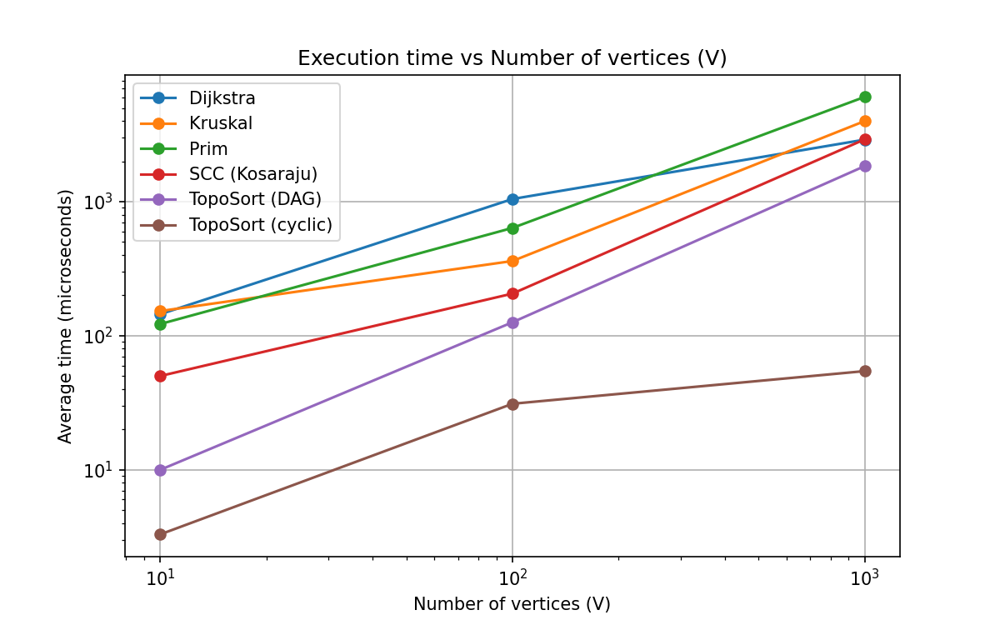
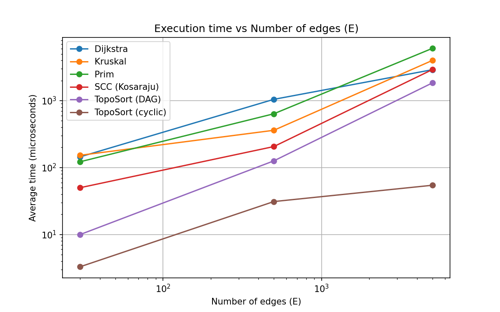

# Assignment 3 — Smart City Infrastructure and Route Planning

## Overview

The program models a city as a graph:
- **Vertices** = city districts (numbered `0 .. V-1`)
- **Edges** = roads (weight = construction cost or distance, random integer 1..100)

The graph is stored as an **adjacency list** (`Graph.adj`) plus a **list of all edges** (`Graph.edges`, used by Kruskal and for counting in-degrees).
Undirected roads are stored in both directions in `adj` and once in `edges`.

Implemented algorithms:

| Task | Algorithms |
|---|---|
| MST | Kruskal (with DSU), Prim (with priority queue) |
| Connectivity | Topological sort (Kahn), SCC (Kosaraju) |
| Shortest paths | Dijkstra (with priority queue) |

## Project structure

```
assignment-3/
├── src/
│   ├── graph/          Edge, Graph, GraphGenerator
│   ├── dsu/            DSU
│   ├── mst/            Kruskal, Prim
│   ├── connectivity/   TopologicalSort, SCC
│   ├── shortestpath/   Dijkstra
│   ├── Main.java       experiments
│   └── Tests.java      tests
├── results/
│   ├── tables/results.csv
│   └── plots/
├── make_plots.py
└── README.md
```

## How to run

```bash
javac -d out src/*/*.java src/*.java     # compile (Java 11+)
java -cp out Tests                       # run tests
java -cp out Main                        # run experiments -> results/tables/results.csv
python make_plots.py                     # make plots (needs matplotlib)
```

## Implementation

- **DSU** — array `parent` and array `rank`. `find` uses *path compression* (every vertex on the path is attached directly to the root). `union` uses *union by rank* (the shorter tree is attached under the taller one). `union` returns `false` if both elements are already in the same set.
- **Kruskal** — sort all edges by weight, go through them, and take an edge if `dsu.union` succeeds (it does not create a cycle). Stop after `V-1` edges. If fewer than `V-1` edges were taken, the graph is not connected (the result is a minimum spanning forest).
- **Prim** — start from a vertex, put its edges into a `PriorityQueue`, repeatedly take the cheapest edge that leads to an unvisited vertex. If the graph is disconnected, Prim restarts from every unvisited vertex (so it also gives a forest, and can be compared with Kruskal). `connected` = only one start was needed.
- **Topological sort (Kahn)** — compute in-degrees, put vertices with in-degree 0 in a queue, remove them one by one and decrease the in-degrees of their neighbours. If the resulting order has fewer than `V` vertices, the graph has a cycle.
- **SCC (Kosaraju)** — (1) DFS on the graph and remember the finishing order, (2) reverse all edges, (3) DFS on the reversed graph in reverse finishing order; every DFS tree is one SCC.
- **Dijkstra** — array `dist` (infinity = unreachable), array `prev` (to restore paths), priority queue of `{vertex, distance}`. Outdated queue entries are skipped. A negative weight throws an exception.

### Why Dijkstra does not work with negative weights

Dijkstra assumes that when a vertex is taken from the queue with the smallest distance, this distance is final, because any other path to it must go through vertices that are farther away and can only add non-negative cost. With a negative edge this is false: a path that looks longer at first can become shorter later. Example: `A→B = 2`, `A→C = 3`, `C→B = -2`. Dijkstra finalizes `B` with distance 2, but the real shortest path `A→C→B` costs 1. Since the finalized vertex is never revisited, the answer is wrong (for negative weights Bellman-Ford should be used).

## Complexity Analysis

Assumptions: graph in an **adjacency list**, priority queue is a **binary heap** (`java.util.PriorityQueue`), V = vertices, E = edges. α(V) is the inverse Ackermann function (practically ≤ 4).

| Algorithm | Time | Space | How V and E affect it |
|---|---|---|---|
| DSU `find` / `union` | O(α(V)) amortized per operation (with both optimizations) | O(V) | Depends only on the number of elements; almost constant |
| Kruskal | O(E log E + E·α(V)) = O(E log E) | O(V + E) | Dominated by sorting E edges; V matters little |
| Prim (binary heap) | O(E log V) (each edge can be pushed once, heap size ≤ E) | O(V + E) | Grows with E; more edges = more heap operations |
| Topological sort (Kahn) | O(V + E) | O(V) | Linear in both |
| SCC (Kosaraju) | O(V + E) (two DFS + reversing the graph) | O(V + E) | Linear in both |
| Dijkstra (binary heap) | O((V + E) log V) | O(V + E) | Grows with E (relaxations) and V (heap extractions) |

**DSU: why the optimizations help.** Without them, a chain of unions can create a tall tree and one `find` costs O(V). *Union by rank* keeps trees low (height ≤ log V). *Path compression* flattens the tree on every `find`, so later `find` calls on the same elements are almost one step. Together they give O(α(V)) amortized, which is practically constant. In our experiment the number of parent steps in `find` is small (for Large: 6238 steps for 6712 `find` calls, less than one step per call).

## Experimental Setup

- **Graph sizes:** Small (V=10, E=30), Medium (V=100, E=500), Large (V=1000, E=5000).
- **Reproducibility:** all graphs are generated with `java.util.Random` with fixed seed `42`.
- **Weights:** random integers from 1 to 100. No self-loops, no duplicate edges.
- **Undirected connected graph (MST):** first a random tree (vertex `i` is connected to a random vertex `j < i`), which guarantees connectivity; then random edges are added until there are E edges.
- **Directed graph with cycles (SCC, Dijkstra, topological sort on cyclic graph):** E random edges `u → v`. It contains cycles.
- **DAG (topological sort):** random edges that always go from a smaller number to a bigger number, so a cycle is impossible.
- **Measurement:** each algorithm runs 5 times, time is measured with `System.nanoTime()`, the average is reported in microseconds. One extra warm-up run (not counted) is made before measuring because of JVM start-up. Graph generation is not included in the time.
- **Dijkstra source:** vertex 0.
- **Counted operations:** Kruskal — sort comparisons, edges examined, DSU `find`/`union` calls and parent steps; Prim — edges examined, heap pushes/polls; Topological sort and SCC — edges examined; Dijkstra — edges examined, heap pushes/polls.

## Results

> Run `java -cp out Main` and paste the table it prints here. (The table below is the output of my run: operation counts are always the same because of the fixed seed, times depend on the computer.)

| Algorithm | Graph | V | E | Avg time (us) | Operations |
|---|---|---|---|---|---|
| Kruskal | Small | 10 | 30 | 152.8 | weight=129; connected=true; sortComparisons=107; edgeExams=14; dsuFinds=28; dsuUnions=14; dsuParentSteps=15 |
| Prim | Small | 10 | 30 | 122.3 | weight=129; connected=true; edgeExams=60; heapPushes=30; heapPolls=30 |
| TopoSort (DAG) | Small | 10 | 30 | 10.0 | hasCycle=false; edgeExams=60 |
| TopoSort (cyclic) | Small | 10 | 30 | 3.3 | hasCycle=true; edgeExams=30 |
| SCC (Kosaraju) | Small | 10 | 30 | 50.1 | components=1; edgeExams=60 |
| Dijkstra | Small | 10 | 30 | 144.8 | reachable=10; edgeExams=30; heapPushes=12; heapPolls=12 |
| Kruskal | Medium | 100 | 500 | 361.1 | weight=1170; connected=true; sortComparisons=3827; edgeExams=164; dsuFinds=328; dsuUnions=164; dsuParentSteps=248 |
| Prim | Medium | 100 | 500 | 637.3 | weight=1170; connected=true; edgeExams=1000; heapPushes=500; heapPolls=500 |
| TopoSort (DAG) | Medium | 100 | 500 | 126.1 | hasCycle=false; edgeExams=1000 |
| TopoSort (cyclic) | Medium | 100 | 500 | 31.1 | hasCycle=true; edgeExams=500 |
| SCC (Kosaraju) | Medium | 100 | 500 | 206.3 | components=1; edgeExams=1000 |
| Dijkstra | Medium | 100 | 500 | 1047.3 | reachable=100; edgeExams=500; heapPushes=150; heapPolls=150 |
| Kruskal | Large | 1000 | 5000 | 3995.5 | weight=13123; connected=true; sortComparisons=50369; edgeExams=3356; dsuFinds=6712; dsuUnions=3356; dsuParentSteps=6238 |
| Prim | Large | 1000 | 5000 | 6050.7 | weight=13123; connected=true; edgeExams=10000; heapPushes=5000; heapPolls=5000 |
| TopoSort (DAG) | Large | 1000 | 5000 | 1843.7 | hasCycle=false; edgeExams=10000 |
| TopoSort (cyclic) | Large | 1000 | 5000 | 54.5 | hasCycle=true; edgeExams=5054 |
| SCC (Kosaraju) | Large | 1000 | 5000 | 2916.8 | components=18; edgeExams=10000 |
| Dijkstra | Large | 1000 | 5000 | 2903.3 | reachable=990; edgeExams=4946; heapPushes=1420; heapPolls=1420 |

Plots (log scale on both axes):




## Comparison and Discussion

> Replace the numbers below with your own results if they differ.

- **Kruskal vs Prim.** Both give the same MST weight on every graph (129, 1170, 13123), as expected. Kruskal does more work in sorting (50369 comparisons on Large) but examines fewer edges because it stops after V-1 edges are taken (3356 of 5000). Prim examines every edge twice (10000 = 2E, because each undirected edge is in two adjacency lists) and does 5000 heap pushes and polls. On dense graphs where E is much bigger than V, Prim with a heap does more heap work; Kruskal's cost is mostly the sort.
- **DSU.** The number of parent steps (6238) is smaller than the number of `find` calls (6712): on average less than one step per `find`. This confirms that path compression and union by rank keep the trees almost flat.
- **SCC.** Edge examinations are exactly 2E (two DFS passes), which matches O(V + E). Time grows roughly proportionally to the graph size. The random Small and Medium graphs have one big SCC (random graphs with E ≥ 3V are usually strongly connected); the Large one has 18 components.
- **Topological sort.** On a DAG the algorithm processes all vertices and edges (2E examinations). On a cyclic graph it stops early, because some vertices never get in-degree 0, so it does less work and is faster. In both cases it correctly reports whether a cycle exists.
- **Dijkstra.** Edge examinations equal the number of edges reachable from the source (E for Small/Medium, 4946 for Large where 10 vertices are unreachable). Heap operations are smaller than E because only improving relaxations push to the heap. The time grows with the graph size as predicted by O((V+E) log V).
- **Theory vs experiment.** Operation counts match the theory well (2E for linear algorithms, E log E comparisons for sorting). Times for the Small graph are very small and noisy (microseconds, JIT compilation, garbage collection), so they are less reliable than the operation counts.

## Testing

`java -cp out Tests` — 30 checks, all pass.

| Case | What is checked |
|---|---|
| Small graph with cycles | Kruskal = Prim = 6 (known answer) |
| Disconnected graph | both report "not connected"; same forest weight (11); Prim finds 2 components |
| Multiple valid MSTs / duplicate weights | all weights equal → Kruskal = Prim = 6 |
| Single vertex | MST weight 0, topological order `[0]`, 1 SCC, Dijkstra distance 0 |
| DAG | topological order is valid (every edge `u→v` has `u` before `v`) |
| Graph with a cycle | topological sort reports a cycle |
| SCC | known graph with components {0,1,2} and {3,4}; each vertex in exactly one component; DAG has V components |
| Dijkstra | known distances and path; unreachable vertex gets infinity and an empty path; negative weight is rejected |
| 20 random graphs (seeds 1–20) | Kruskal weight = Prim weight and graph is connected; topological order valid on DAGs; each vertex in exactly one SCC; Dijkstra distances satisfy `dist[v] ≤ dist[u] + w` for every edge |

## Conclusion

- **MST:** both algorithms find the same minimum cost. Kruskal is simple and good when edges are already given as a list or the graph is sparse; Prim is natural when the graph is stored as an adjacency list and is dense.
- **Topological sort** is the right tool for dependencies between services (and it also detects cycles); **SCC** is the right tool to find groups of locations that can all reach each other (for example in one-way road networks). Both are linear, O(V + E), and scale well.
- **Dijkstra** is the right choice for shortest routes when all weights are non-negative; it is not suitable for negative weights.
- Operation counts agree with the theoretical complexities, while measured times for small graphs are noisy.
